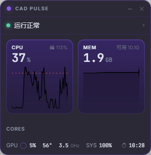

<div align="center">

# ⬢ CAD Pulse

**AutoCAD 性能监控悬浮窗 — 单核视角，一眼看清卡顿根源**

*An always-on-top performance monitor for AutoCAD, built around the metric that actually matters: single-core saturation.*

[](LICENSE)
[]()
[](https://v2.tauri.app)

简体中文 · [English](#english) 

</div>

---

## 为什么做这个工具

AutoCAD 的 2D 运算主要吃**单核 CPU**。任务管理器显示的"总 CPU 8%"毫无参考价值——真实情况往往是 20 个核里 1 个核打满 100%，其余全闲着。这种"单核饱和"正是图纸越画越卡的典型根源，而市面上的监控工具都不直接展示它。

CAD Pulse 为此而生：

- **单核口径**（100% = 一个核满载）+ **最忙核** + **20 核实时条形图**——哪个核被 AutoCAD 掐住，一眼看到
- **自动诊断**：单核满载 → 清理图纸垃圾数据；GPU 忙 → 切换硬件加速；低负载仍卡 → 检查外部参照/杀毒扫描
- 暗黑玻璃质感 HUD 悬浮窗 + 托盘常驻，画图时零打扰

## 截图

| 悬浮 HUD | 详情面板 |
|:---:|:---:|
|  |  |

> 图为演示模式（演示数据）。托盘图标为一枚随 CPU 负载变色的进度环。

## 功能

- 🪟 **悬浮 HUD**（置顶 / 可拖动 / 可折叠成迷你环）：CPU（单核口径）· 内存曲线、每核负载条、GPU% · 温度、CPU 频率、运行时长、诊断行
- 📊 **详情面板**（托盘左键 / 点 HUD 状态行）：三张 5/30 分钟曲线卡（峰值 · 均值 · 频率 · 显存）、每核实时负载、**事件日志**（自动记录 AutoCAD 启动 / 关闭 / CPU 持续满载 / GPU 繁忙 / 内存吃紧，本地持久化）
- 🩺 **自动诊断** + **CAD 卡顿速查命令**（`-PURGE` Regapps、`SCALELISTEDIT` 重置、`AUDIT`、`GFXDX12=0`、天正图形导出……）
- 📋 **一键复制摘要**：把当前负载 + 峰值 + 诊断结论复制成文本，贴给同事 / 论坛求助
- 🔔 托盘环图标实时变色（紫 → 琥珀 → 红）、悬停多行摘要、开机自启
- 🧊 Windows 原生 Acrylic 暗色玻璃（远程桌面自动回退深色）
- 🪶 轻量：安装包 2 MB，常驻约 45 MB 内存；AutoCAD 未运行时自动降频轮询

## 下载安装

从 [**Releases**](https://github.com/WikG1018/cad-pulse/releases) 下载 `CAD.Pulse_x.x.x_x64-setup.exe`（约 2 MB）安装即可。无需配置，打开 AutoCAD 后自动开始监控。

> 💡 安装包未做代码签名（个人开源项目），Windows SmartScreen 可能弹窗「已保护你的电脑」——点「更多信息 → 仍要运行」即可；也可选择校验 MSI。

> GPU 指标依赖 NVIDIA 驱动（NVML）；无 N 卡时自动隐藏 GPU 卡。系统需求：Windows 10/11 x64。

## 使用

**两个界面**：桌面**悬浮 HUD**（常驻小窗，可折叠/拖动/隐藏）+ **详情面板**（完整数据），首次启动会自动打开面板一次。

| 想做什么 | 操作 |
|---|---|
| 打开详情面板 | HUD 标题栏 **▣ 按钮** / 点 HUD 诊断状态行 / **托盘左键** |
| 托盘在哪 | 任务栏**右下角**（Win11 可能收在 `^` 折叠区，建议拖到任务栏固定）；**悬停**=负载摘要，**右键**=菜单（悬浮窗开关/演示模式/开机自启/退出） |
| 悬浮窗挡图了 | 拖到角落 / 点 ─ 折叠成迷你条 / 点 ✕ 隐藏（托盘菜单找回） |

监控数据说明：

- **CPU 单核口径**：`100% = 一个核满载`（AutoCAD 2D 主要吃单核，这是判断卡顿的关键口径）；HUD 卡片和面板同时显示**总量口径**（任务管理器口径）对照
- **N 核条**：全部逻辑核的实时负载——AutoCAD 场景的典型画面是"1 根红条 + 其余空闲"
- 没开 AutoCAD 时显示"等待"；点 HUD 上的「▶ 试试演示模式」可先体验
- 打开 AutoCAD 后自动 1 Hz 采样（面板可调 0.5 / 1 / 2 s）

## 诊断规则

| 表现 | 结论 | 处理 |
|---|---|---|
| 单核持续 ≥85% 且最忙核同步打满 | **CPU 单线程瓶颈**（图纸垃圾 / 填充 / 天正代理对象） | `-PURGE`（Regapps）→ `SCALELISTEDIT` 重置 → `AUDIT`；冻结不编辑图层 |
| GPU ≥60% | **渲染管线忙** | `GRAPHICSCONFIG` 开关对比；`GFXDX12=0`；换 Studio 驱动 |
| CPU、GPU 都低但仍卡 | **等待型** | 检查失效外部参照 / 字体路径；杀毒排除 DWG 目录；天正版本匹配（T20 V8.0+ 支持 CAD 2024） |
| 系统可用内存 <2 GB | **内存压力** | 关大程序；大图拆分外部参照 |

## 开发

```bash
pnpm install
pnpm tauri dev                    # 开发运行
CAD_PULSE_DEMO=1 pnpm tauri dev   # 演示模式
pnpm tauri build                  # 打包（NSIS + MSI）
```

技术栈：Tauri 2 · React 18 · TypeScript；Rust 侧 [sysinfo](https://github.com/GuillaumeGomez/sysinfo)（进程 / 系统）· [nvml-wrapper](https://github.com/Cldfire/nvml-wrapper)（NVIDIA）· tiny-skia（托盘环图标）· [window-vibrancy](https://github.com/tauri-apps/window-vibrancy)（亚克力玻璃）。

设计体系与质量门禁见 [DESIGN.md](DESIGN.md)。欢迎 Issue / PR。

## <a id="english"></a>English

**CAD Pulse** is a lightweight always-on-top performance monitor for AutoCAD on Windows, built for the 2D drafting reality: AutoCAD is mostly **single-threaded**, so a busy core count of 1 is what makes drawings sluggish — not total CPU. The HUD shows CPU on a per-core scale (100% = one core saturated), busiest-core, per-core live bars, memory, GPU stats, and an auto diagnosis that maps symptoms to fixes (drawing bloat purge, hardware acceleration toggles, xref/AV latency checks). Dark-glass UI (native acrylic), tray-resident, event log, one-click summary copy. ~2 MB installer, ~45 MB RAM. NVIDIA GPUs supported via NVML.

## License

[MIT](LICENSE) © WikG1018
